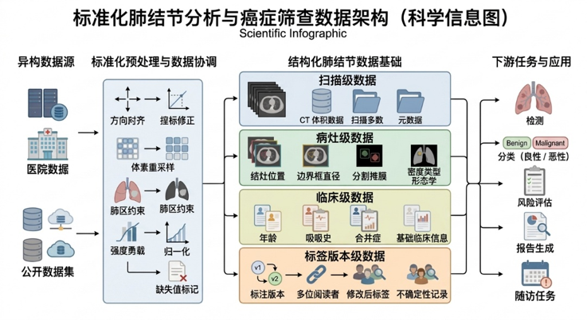
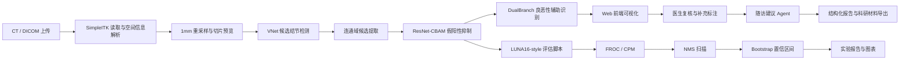

# 肺结节智能检测与临床辅助决策系统

项目全称：面向肺癌早筛的肺结节智能分析与临床辅助决策关键技术研究

项目类型：大学生创新创业训练计划，创新训练项目

项目周期：2026 年 5 月至 2028 年 4 月

我的角色：项目负责人，负责需求分析、技术路线设计、模块拆解、组内任务安排、老师/专家沟通、比赛节奏推进、申报书与建议书撰写。

## 一句话介绍

本项目面向肺癌早筛场景，构建一个从 CT/DICOM 数据导入、肺结节候选检测、假阳性抑制、良恶性辅助识别、医生复核到随访建议生成的医学影像 AI 原型系统，并配套 LUNA16-style 公开数据评估和科研实验闭环。

## 项目为什么值得看

它不是一个只会跑模型的 Demo，而是围绕医学 AI 落地需要的完整链路展开：

- 医学数据链路：支持 DICOM/CT 影像读取、重采样、切片预览、坐标转换和结果结构化。
- 模型推理链路：使用 VNet 做候选检测，使用 ResNet-CBAM 做假阳性抑制，使用双分支网络做良恶性识别。
- 医生复核链路：支持医生补充/确认/驳回结节，形成最终结节列表。
- Agent 辅助链路：根据结节大小、类型、数量、风险因素和缺失字段生成随访建议，同时保留安全边界。
- 科研评估链路：接入 LUNA16-style FROC/CPM、NMS、bootstrap CI、hard-negative mining 和跨 subset 外部验证。

## 数据架构图

下图来自项目整理阶段，用于表达标准化肺结节分析和癌症筛查数据架构。



## 系统架构



## 技术栈

| 模块 | 技术 |
|---|---|
| Web 后端 | Python、Flask、Flask-CORS |
| 医学影像处理 | SimpleITK、pydicom、NumPy、SciPy、scikit-image |
| 深度学习 | PyTorch、VNet、ResNet18-3D-CBAM、DualBranchResNet |
| 前端展示 | HTML、CSS、JavaScript、Canvas、Fetch API |
| 桌面标注 | PyQt6、QPainter、QImage、QPixmap |
| 评估实验 | LUNA16-style FROC/CPM、NMS、bootstrap、hard-negative mining |
| 文档产出 | Markdown、CSV、JSON、科研图表、答辩材料 |

## 核心模块

| 模块 | 文件或目录 | 作用 |
|---|---|---|
| Web 服务层 | `FJJ System/app2.py` | 提供上传、检测、识别、医生复核、Agent 随访建议等接口 |
| 诊断引擎 | `FJJ System/engine.py` | 封装 CT 读取、重采样、模型推理、坐标转换和结果组织 |
| 模型结构 | `FJJ System/models.py` | 定义 VNet、ResNet-CBAM、双分支分类网络 |
| 随访 Agent | `FJJ System/agent/` | 风险分层、缺失字段检查、Fleischner/Lung-RADS 风格提示、安全审计 |
| 复核模块 | `FJJ System/doctor_review.py` | 合并模型检测结果和医生补充结节，形成病例上下文 |
| 实验脚本 | `FJJ System/experiments/` | LUNA16 候选评分、FROC、NMS、bootstrap、hard-negative mining |
| 测试用例 | `FJJ System/tests/` | 覆盖 FROC、bootstrap、NMS、Agent 规则、数据管理等逻辑 |
| 标注工具 | `dicom.annotator5.2(1).py` | PyQt DICOM 标注工具，支持矩形框标注与 CSV 导出 |

## 我负责的具体工作

- 设计“检测 - 复核 - Agent - 评估 - 材料生成”的项目闭环，而不是只停留在模型推理。
- 编写 Flask 后端接口，完成 DICOM 上传、病例列表、检测触发、识别触发、医生复核保存、随访建议生成等功能。
- 整理医学影像处理流程，使用 SimpleITK 保留 spacing、origin、direction 等空间信息，降低像素坐标与世界坐标混乱的风险。
- 设计模型推理链路：VNet 负责候选检测，ResNet-CBAM 负责假阳性过滤，DualBranch 负责结节性质识别。
- 编写 LUNA16-style 实验脚本，完成 candidates_V2 流式评分、FROC/CPM 计算、NMS 半径扫描、分区验证和 bootstrap 置信区间。
- 组织 hard-negative mining 实验，针对高分假阳性进行挖掘、合并训练清单、重训 FPRED 分支，并在外部 subset 上复评。
- 编写大创申报书、项目计划书、建议书、答辩讲稿和科研报告，推动项目从演示系统走向可复现实验。

## 关键结果

| 实验或功能 | 数据范围 | 结果 |
|---|---|---|
| 本地病例闭环 | 3 个病例、607 张 DICOM 切片 | 完成上传、检测、医生复核、Agent 随访建议和结果导出 |
| 本地 review-proxy | 11 个 reference nodules | proxy precision 1.0000，proxy recall 0.6364 |
| FPRED 独立候选测试 | subset0/test，103 candidates | AUC 0.9926；threshold 0.30 下 TP=6、FP=2、TN=94、FN=1 |
| FPRED bootstrap CI | series 级重采样 | AUC 0.9926，95% CI 0.9731-1.0000 |
| subset0 全量 candidates_V2 | 89 series、112 annotations、79,135 predictions | bridge CPM 0.6020 |
| subset0 分区验证 | calibration 55 series；evaluation 34 series | fixed 10 mm NMS 后 CPM 0.6888，相比 no NMS 的 0.6199 提升 11.11% |
| hard-negative mining | calibration 挖掘 512 个 hard negatives | subset0 evaluation fixed 10 mm CPM 0.8648，95% CI 0.7560-0.9317 |
| subset1 外部验证 | 89 series、128 annotations | hard-negative fixed 10 mm CPM 0.6161，95% CI 0.5217-0.7099 |
| subset2 第三方外部验证 | 89 series、128 annotations | hard-negative fixed 10 mm CPM 0.6652，95% CI 0.5892-0.7494 |
| subset1+subset2 pooled | 178 series、256 annotations | CPM gain +0.0759，paired bootstrap gain>0 比例 0.9880 |

## 设计理念

1. 先做可解释的工程闭环，再追求模型指标。医学 AI 项目如果没有上传、显示、复核、导出和安全边界，即使模型分数高也很难说服使用者。
2. 把“医生复核”作为系统核心，而不是把 AI 输出当成最终诊断。系统定位为辅助工具，所有建议都需要医生结合原始 CT、病史和指南确认。
3. 用公开数据评估约束项目表达。README 中明确区分候选分类 AUC、FROC/CPM、subset 桥接评估和完整临床验证，避免夸大。
4. 对调参保持审慎。NMS 半径只在 calibration 上选择，再固定到 evaluation 上报告，避免在同一数据上“选参数又报成绩”。
5. 保留失败和边界。当前项目不宣称可直接临床使用，也不宣称完整 LUNA16 官方世界前沿成绩。

## 运行方式

说明：GitHub 仓库不包含模型权重、原始 CT、DICOM、LUNA16 数据和隐私病例资料，所以本仓库主要用于代码与项目能力展示。若要完整运行，需要自行准备合法数据和模型权重。

```bash
cd "01_重点项目_肺结节智能检测与临床辅助决策系统/FJJ System"
pip install -r requirements.txt
python app2.py
```

启动后默认访问：

```text
http://127.0.0.1:5001
```

需要准备的本地资源：

- `models/` 下的 VNet、FPRED、DualBranch 权重文件
- 合规来源的 CT/DICOM 测试数据
- 如运行 LUNA16-style 评估，需要本地 LUNA16 数据和 candidates_V2

权重路径也可以通过环境变量覆盖：`LUNG_NODULE_MODEL_DIR`、`LUNG_NODULE_VNET_W`、`LUNG_NODULE_RESNET_W`、`LUNG_NODULE_MALIGNANCY_W`。

## API 功能概览

| 接口 | 作用 |
|---|---|
| `POST /upload` | 上传并解析 DICOM 序列 |
| `GET /get_patients` | 获取病例列表 |
| `GET /get_patient_detail/<pid>` | 获取病例详情 |
| `GET /detect` | 触发结节候选检测 |
| `POST /identify` | 触发良恶性辅助识别 |
| `GET /doctor/review/<pid>` | 读取医生复核记录 |
| `POST /doctor/review/save` | 保存医生复核、补充结节和临床上下文 |
| `POST /agent/followup` | 生成结构化随访建议 |

## 科研边界

- 当前结果可支撑“大创项目展示、工程闭环、公开数据子集验证、实验方法设计和后续论文推进”。
- 当前结果不能直接作为临床诊断工具使用。
- 当前评估主要是 candidates_V2 false-positive reduction bridge evaluation，不等同于完整 LUNA16 官方提交。
- 原始医学数据、患者隐私、模型权重和申报书个人信息均未上传 GitHub。

## 下一步计划

- 扩展更多 LUNA16 subset，继续验证 hard-negative FPRED 的跨子集泛化。
- 加入概率校准、消融实验和更完整的端到端 detection submission。
- 强化医生复核界面，补齐病例级审计、导出报告模板和操作日志。
- 将 Agent 输出进一步结构化，明确指南适用条件、缺失字段和风险提示。
