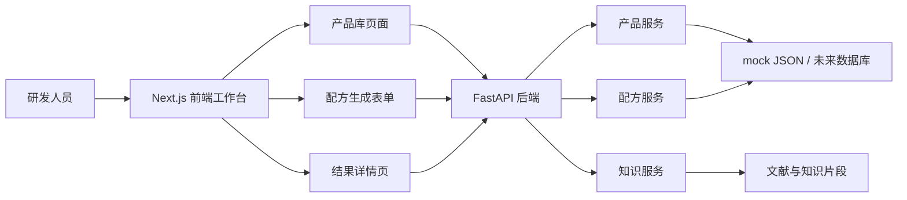

# AKK 菌产物配方智能生成平台

## 一句话介绍

面向食品研发和创新创业场景，开发一个用于 AKK 菌相关产品库管理、配方生成、风险提示和实验建议展示的全栈 Web 原型平台。

## 技术栈

- 前端：Next.js、React、TypeScript、Tailwind CSS、Zod
- 后端：FastAPI、Pydantic、Python
- 数据：SQLite 预留、mock JSON 数据、结构化知识片段
- 工程：Docker、Docker Compose、Makefile、RESTful API

## 系统架构



## 功能模块

| 模块 | 说明 |
|---|---|
| Dashboard | 展示产品数量、生成配方数量、待验证方案、中高风险方案和最近生成结果 |
| AKK 产品库 | 查看产品形态、功能性质、应用适配性、证据等级和风险等级 |
| 产品详情 | 展示稳定性、安全合规、应用方向、证据等级和风险信息 |
| 配方生成 | 使用分步骤表单收集应用场景、目标功能、约束条件和风险偏好 |
| 配方结果 | 输出推荐比例、预测结果、置信度、风险提示、验证测试和工艺建议 |
| API 文档 | 在 `docs/` 中整理接口、数据契约、产品规格和部署说明 |

## 我负责的具体贡献

- 将“AKK 菌产物配方”这个模糊创赛想法拆成产品库、配方生成、结果解释、风险提示、验证建议等可开发模块。
- 设计前后端分层：前端负责工作台和交互流程，后端负责数据校验、业务逻辑和结果组织。
- 编写 FastAPI router、Pydantic schema、service、repository，避免接口层直接读取数据文件。
- 设计配方结果的数据结构，让结果不仅给出“配比”，还包含置信度、风险等级、验证测试和工艺建议。
- 编写 `API_SPEC`、`DATA_CONTRACT`、`PRODUCT_SPEC`、`UI_SPEC` 等文档，保证项目能被外部人员快速理解。

## 运行方式

```bash
cd "02_重点项目_AKK菌产物配方智能生成平台"
docker compose up --build
```

访问地址：

```text
Web: http://localhost:3000
API: http://localhost:8000
Health: http://localhost:8000/health
```

## 验收路径

1. 打开 Dashboard，查看产品和配方概览。
2. 进入产品库，查看 AKK 产物列表和证据等级。
3. 进入产品详情页，查看适用场景、稳定性、安全合规信息。
4. 进入配方生成页面，填写目标应用、功能诉求、约束条件。
5. 查看配方结果详情，确认配比、风险提示和验证建议。

## 当前边界

- 当前是产品级 mock 原型，不接真实数据库。
- 当前不接真实大模型和真实配方引擎。
- 所有配方输出均为研发实验建议，不代表最终上市配方。
