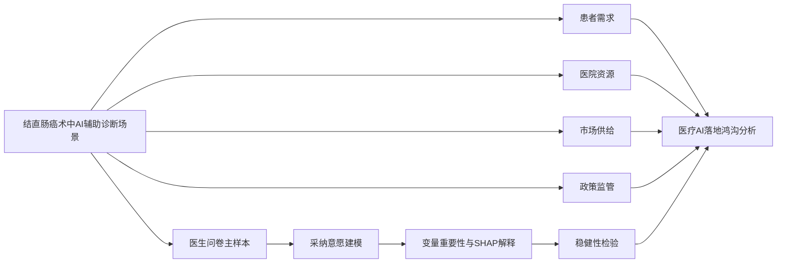

# 医疗 AI 临床落地统计建模

## 一句话介绍

以结直肠癌术中 AI 辅助诊断为实证切口，构建医疗 AI 临床落地的统计建模框架，分析医生采纳意愿、医院资源、市场供给和政策监管之间的关系。

## 技术栈

- Python、Pandas、NumPy、scikit-learn、statsmodels
- SHAP、Matplotlib、Seaborn
- SPSS、Excel
- 问卷分析、稳健性检验、政策情景模拟、变量重要性解释

## 研究设计

## 数据库分层

| 层级 | 数据库 | 作用 |
|---|---|---|
| 案例实证数据库 | Doctor_Main | 医生问卷，围绕结直肠癌术中 AI 辅助诊断系统建立主模型 |
| 案例背景数据库 | CRC_Case_Background | 支撑结直肠癌诊疗背景、技术场景和痛点说明 |
| 临床场景数据库 | CRC_Clinical_Context | 支撑内镜、病理、术中判断、筛查和诊疗流程解释 |
| 医疗 AI 格局数据库 | Patient_Demand、Hospital_Resource、Market_Supply、Policy_Regulation | 用于验证医疗 AI 落地的共性基础 |

## 我负责的具体贡献

- 参与确定“先小后大，再回到应用”的论文结构：先从结直肠癌案例切入，再扩展到医疗 AI 共性落地问题。
- 整理医生问卷、医院资源、市场供给、政策监管等多源数据口径。
- 使用 Python 完成模型比较、变量重要性、SHAP 解释、分群画像、政策情景模拟和稳健性检验。
- 输出模型结果 CSV、图表、论文结构说明和结果汇总文件。
- 将“算法是否有效”转化为“医生是否采纳、医院是否具备条件、制度是否支持”的落地问题。

## 产出内容

- `待处理统计建模分析指标/01_医生主模型`：医生采纳模型、变量重要性、SHAP 分析。
- `待处理统计建模分析指标/03_医院资源_HAIRI`：医院资源与准备度分析。
- `待处理统计建模分析指标/04_论文图表`：论文图表与结果材料。
- `正文结构.txt`：论文叙事逻辑与数据库定位。

## 当前边界

- 原始问卷和敏感支撑材料未上传 GitHub。
- 仓库保留的是可展示的代码、衍生结果、图表和方法说明。
