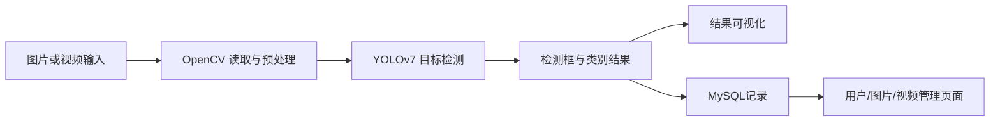

# YOLOv7 车辆检测与视频管理系统

## 一句话介绍

基于 YOLOv7、OpenCV 和 MySQL，开发一个用于车辆目标检测、图片/视频记录管理和用户信息管理的计算机视觉系统。

## 技术栈

- Python、PyTorch、YOLOv7、OpenCV
- MySQL、PyMySQL
- PyQt / 页面模块
- 目标检测、视频读取、结果管理

## 系统架构



## 我负责的具体贡献

- 在 YOLOv7 官方代码基础上，增加车辆检测应用入口和业务页面模块。
- 编写数据库连接与记录管理逻辑，将检测图片、视频和用户信息结构化保存。
- 对检测流程进行本地化改造，支持图片/视频输入和检测结果展示。
- 将数据库密码等敏感配置改为环境变量读取，避免上传明文密码。

## 运行说明

```bash
cd "04_计算机视觉_YOLOv7车辆检测与视频管理系统"
pip install -r requirements.txt
python detect.py --weights yolov7.pt --source your_image_or_video
```

数据库相关环境变量：

```text
MYSQL_HOST
MYSQL_USER
MYSQL_PASSWORD
MYSQL_DATABASE
```

## 当前边界

- 仓库不包含 `.pt/.pth` 权重、视频、数据库 dump 和打包文件。
- 原始 YOLOv7 框架内容较多，作品集关注点是本地应用改造、检测流程和数据管理。
