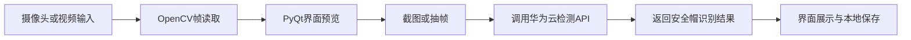

# 智慧工地安全帽检测系统（云 API 版）

我基于 PyQt5、OpenCV 和华为云机器视觉 API 完成视频播放、录制、截图、云端安全帽检测和结果展示链路。

## 技术栈

- Python、PyQt5、OpenCV
- 华为云 ModelArts / 机器视觉模型 API
- APIG SDK、环境变量密钥管理

## 功能流程



## 我负责的具体贡献

- 设计 PyQt 主界面，完成视频播放、摄像头读取、截图和结果显示。
- 使用 OpenCV 处理视频帧，并将关键帧送入云端模型 API。
- 集成华为云 APIG SDK，完成请求签名、接口调用和返回结果解析。
- 将云平台 AK/SK 改为从环境变量读取，避免在 GitHub 中暴露密钥。

## 运行说明

```bash
cd "05_计算机视觉_智慧工地安全帽检测系统_云API版"
pip install PyQt5 opencv-python requests
python "main(gongdi).py"
```

需要配置：

```text
HUAWEI_CLOUD_AK
HUAWEI_CLOUD_SK
```

## 当前边界

- 云端模型和接口需要用户自己的华为云账号与已部署服务。
- 仓库只保留应用代码和示例素材，不上传真实监控视频和密钥。
