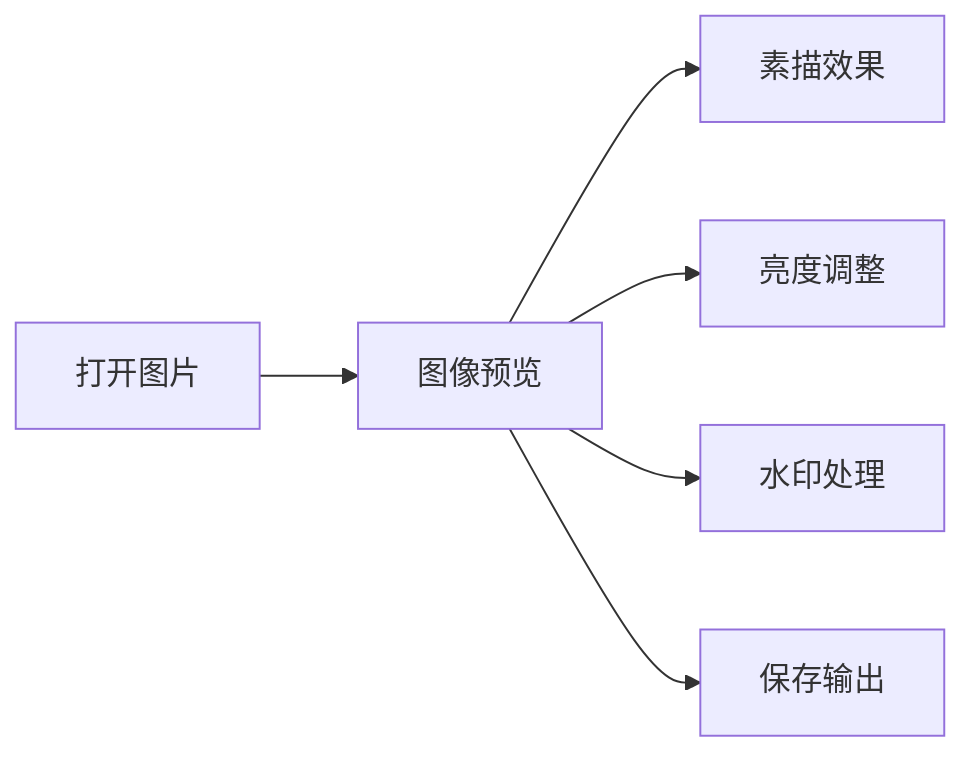

# PyQt 图像处理工具

我基于 PyQt5、OpenCV 和 Pillow 实现图片打开、预览、素描效果、亮度调整、水印和保存等桌面图像处理功能。

## 技术栈

- Python、PyQt5
- OpenCV、Pillow、NumPy
- Qt 信号槽、桌面 GUI 布局

## 功能模块



## 我负责的具体贡献

- 设计 PyQt 主窗口和功能按钮布局。
- 使用 OpenCV/Pillow 完成图像读取、处理和显示转换。
- 封装亮度调整、素描效果和保存逻辑。
- 管理 GUI 状态、图片对象转换与用户交互流程，保持处理前后预览和保存状态一致。

## 运行方式

```bash
cd "07_桌面应用_PyQt图像处理工具"
python main.py
```
