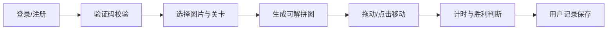

# PyQt 拼图游戏

## 一句话介绍

基于 PyQt5 开发的 3x3 拼图小游戏，包含登录注册、验证码、关卡选择、计时和用户记录等完整交互流程。

## 技术栈

- Python、PyQt5
- Qt 信号槽
- 本地文件存储、验证码生成、计时器

## 功能结构



## 我负责的具体贡献

- 实现登录、注册、验证码和用户资料页面。
- 实现拼图切片、随机打乱、移动规则和胜利判断。
- 使用本地文件保存用户信息和游戏记录。
- 练习多窗口切换、事件处理和游戏状态管理。

## 运行方式

```bash
cd "08_桌面游戏_PyQt拼图游戏"
python main.py
```
