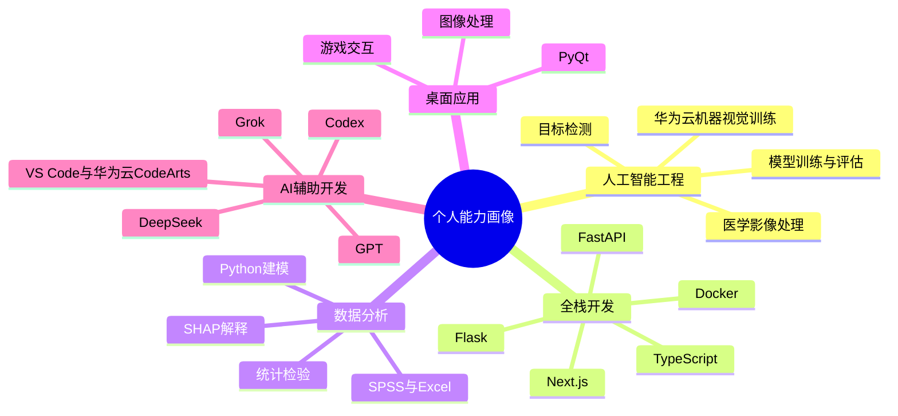

# 林世宇｜编程项目作品集

这个仓库用于实习岗位初筛展示，整理了我从大一到大二阶段完成和持续推进的编程、人工智能、数据分析与桌面应用项目。仓库不是简单备份，而是按“招聘者能快速看懂”的方式重新命名、分组和说明。

## 快速导航

| 序号 | 项目 | 方向 | 主要技术 | 推荐阅读 |
|---:|---|---|---|---|
| 01 | [肺结节智能检测与临床辅助决策系统](./01_重点项目_肺结节智能检测与临床辅助决策系统/) | 医学 AI / 大创重点项目 | Python、Flask、PyTorch、SimpleITK、DICOM、VNet、ResNet-CBAM、LUNA16-style FROC | 重点推荐 |
| 02 | [AKK 菌产物配方智能生成平台](./02_重点项目_AKK菌产物配方智能生成平台/) | AI 产品原型 / 全栈 Web | Next.js、React、TypeScript、FastAPI、Pydantic、SQLite、Docker | 重点推荐 |
| 03 | [医疗 AI 临床落地统计建模](./03_数据分析_医疗AI临床落地统计建模/) | 数据分析 / 统计建模 | Python、Pandas、scikit-learn、statsmodels、SHAP、SPSS | 数据分析岗位推荐 |
| 04 | [YOLOv7 车辆检测与视频管理系统](./04_计算机视觉_YOLOv7车辆检测与视频管理系统/) | 目标检测 / 视频管理 | Python、PyTorch、YOLOv7、OpenCV、MySQL、PyMySQL | 视觉方向推荐 |
| 05 | [智慧工地安全帽检测系统（云 API 版）](./05_计算机视觉_智慧工地安全帽检测系统_云API版/) | 计算机视觉 / 云平台调用 | Python、PyQt5、OpenCV、华为云 ModelArts API、APIG SDK | 云 AI 应用 |
| 06 | [智慧工地安全帽检测系统（基础版）](./06_计算机视觉_智慧工地安全帽检测系统_基础版/) | 课程实践 / API 调用 | Python、PyQt5、OpenCV、华为云 API | 学习迭代 |
| 07 | [PyQt 图像处理工具](./07_桌面应用_PyQt图像处理工具/) | 桌面应用 / 图像处理 | Python、PyQt5、OpenCV、Pillow、NumPy | GUI 能力 |
| 08 | [PyQt 拼图游戏](./08_桌面游戏_PyQt拼图游戏/) | 桌面游戏 / 交互设计 | Python、PyQt5、验证码、登录注册、本地存储 | 交互能力 |
| 09 | [手势识别贪吃蛇](./09_交互游戏_手势识别贪吃蛇/) | 人机交互 / OpenCV | Python、OpenCV、cvzone、HandTracking、JSON | 趣味项目 |

## 作品集能力概览

## 最能体现实习匹配度的项目

### 1. 肺结节智能检测与临床辅助决策系统

这是当前最重要的项目，也是大创训练计划的核心项目。它不是单一模型 Demo，而是把 CT/DICOM 导入、肺结节候选检测、假阳性抑制、良恶性识别、医生复核、随访建议 Agent、公开数据评估和科研材料生成串成闭环。

已整理出的可展示结果包括：

- 本地病例闭环：3 个病例、607 张 DICOM 切片，完成检测、医生复核、结果导出和随访建议生成。
- 公开数据评估：接入 LUNA16 风格评估流程，完成 subset0、subset1、subset2 多阶段实验记录。
- 模型指标：FPRED 独立候选测试 AUC 0.9926，series-level bootstrap 95% CI 为 0.9731-1.0000。
- 检测层指标：subset0 evaluation fixed 10 mm NMS 后 CPM 0.6888；hard-negative mining 后 subset0 evaluation fixed 10 mm CPM 0.8648。
- 外部验证：subset1 fixed 10 mm CPM 0.6161，subset2 fixed 10 mm CPM 0.6652；pooled subset1+subset2 CPM gain +0.0759。

### 2. AKK 菌产物配方智能生成平台

这是一个更偏产品化的全栈项目：用 Next.js 做前端工作台，用 FastAPI 做后端接口，用结构化 mock 数据模拟产品库、配方生成、风险提示和实验建议。它展示了我把一个科研/商业设想拆成页面、接口、数据契约和验收路径的能力。

### 3. 医疗 AI 临床落地统计建模

该项目以“结直肠癌术中 AI 辅助诊断”为实证切口，扩展到医疗 AI 临床落地的共性问题。它覆盖医生采纳意愿建模、变量重要性分析、SHAP 解释、稳健性检验、政策情景模拟和医院资源分析。

## 我在这些项目中的主要贡献

- 负责肺结节大创小组方向规划、需求拆解、功能模块设计、技术资料检索、与老师和专家沟通、比赛/申报材料组织。
- 开发 Flask 医学影像 Web 原型，设计 DICOM 上传、CT 预览、检测触发、识别结果展示、医生复核和随访建议接口。
- 设计并实现 LUNA16-style 实验脚本，覆盖候选评分、NMS、FROC/CPM、bootstrap CI、hard-negative mining 和外部子集验证。
- 搭建 AKK 配方平台的前后端架构，明确 API、数据契约、页面流程、风险提示和验证建议。
- 使用 Python 完成统计建模、机器学习、SHAP 解释、图表输出和结果汇总。
- 使用 PyQt、OpenCV、华为云 ModelArts/API 完成多个视觉和桌面交互项目。

## 技术栈

| 类型 | 技术 |
|---|---|
| 编程语言 | Python、Java、SQL、MATLAB、TypeScript、JavaScript |
| AI / 数据 | PyTorch、OpenCV、SimpleITK、Pandas、NumPy、scikit-learn、statsmodels、SHAP、SPSS |
| Web 后端 | Flask、FastAPI、Pydantic、SQLite、MySQL、PyMySQL |
| Web 前端 | Next.js、React、TypeScript、Tailwind CSS、HTML、CSS、JavaScript |
| 桌面应用 | PyQt5、PyQt6、Qt 信号槽、Pillow |
| 工具平台 | GitHub、VS Code、华为云 CodeArts、华为云 ModelArts、Docker、Excel、Figma、Photoshop |
| AI 辅助开发 | GPT、DeepSeek、Grok、Codex |

## 证书与语言

- 英语四级：540
- 英语六级：430
- 华为人工智能 AI Developer HCIP
- 语言能力：中文、英文

## 仓库安全说明

为了适合作品集公开或半公开展示，本仓库已主动排除以下内容：

- 医学原始影像数据：DICOM、MHD/RAW、NIfTI、LUNA16 原始文件
- 模型权重与大文件：`.pt`、`.pth`、`.onnx`、TensorRT engine、压缩包、视频
- 隐私材料：原始申报书、手机号、邮箱、用户账号文件、数据库 dump
- 本地环境：`.venv`、`node_modules`、`.next`、`dist`、`build`
- 密钥信息：云平台 AK/SK、API token、数据库密码均不提交，运行时通过环境变量读取

这个仓库的定位是“展示我的项目能力”，不是临床软件、生产系统或可直接商用产品。
