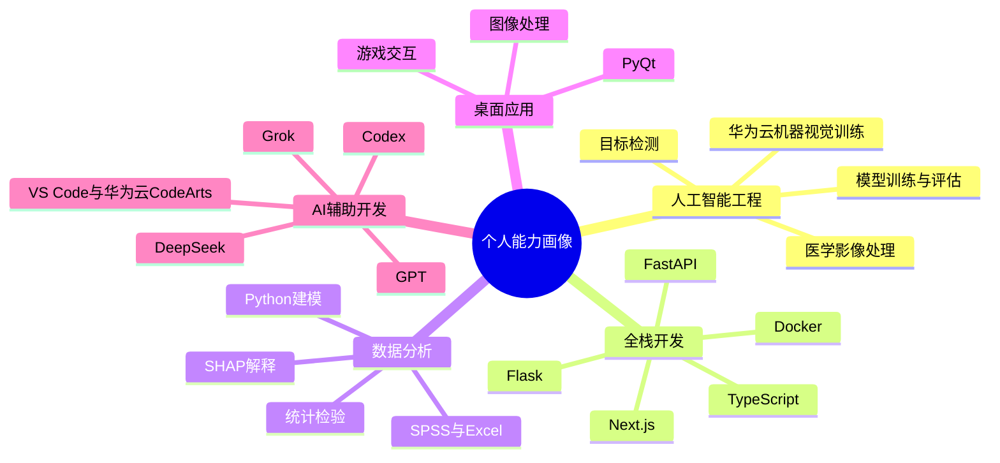

# 林世宇｜编程项目作品集

我持续开发并维护人工智能、医学影像、数据分析、算法工程与桌面应用项目。每个目录均包含源代码、技术说明、运行方式和已完成的验证结果。

## 快速导航

| 序号 | 项目 | 方向 | 主要技术 |
|---:|---|---|---|
| 01 | [肺结节智能检测与临床辅助决策系统](./01_重点项目_肺结节智能检测与临床辅助决策系统/) | 医学 AI | Python、Flask、PyTorch、SimpleITK、DICOM、VNet、ResNet-CBAM、FROC/CPM |
| 02 | [AKK 菌产物配方智能生成平台](./02_重点项目_AKK菌产物配方智能生成平台/) | AI 应用 / 全栈 Web | Next.js、React、TypeScript、FastAPI、Pydantic、SQLite、Docker、LangGraph |
| 03 | [医疗 AI 临床落地统计建模](./03_数据分析_医疗AI临床落地统计建模/) | 数据分析 / 统计建模 | Python、Pandas、scikit-learn、statsmodels、SHAP、SPSS |
| 04 | [YOLOv7 智能座舱视觉应用](./04_计算机视觉_YOLOv7车辆检测与视频管理系统/) | 目标检测 / 视频处理 | Python、PyTorch、CUDA、YOLOv7、OpenCV、PyQt5、MySQL |
| 05 | [智慧工地安全帽检测系统（云 API 版）](./05_计算机视觉_智慧工地安全帽检测系统_云API版/) | 计算机视觉 / 云推理 | Python、PyQt5、OpenCV、ModelArts API、APIG SDK |
| 06 | [智慧工地安全帽检测系统（基础版）](./06_计算机视觉_智慧工地安全帽检测系统_基础版/) | 图像检测 / API 集成 | Python、PyQt5、OpenCV、华为云 API |
| 07 | [PyQt 图像处理工具](./07_桌面应用_PyQt图像处理工具/) | 桌面应用 / 图像处理 | Python、PyQt5、OpenCV、Pillow、NumPy |
| 08 | [PyQt 拼图游戏](./08_桌面游戏_PyQt拼图游戏/) | 桌面应用 / 状态管理 | Python、PyQt5、Qt 信号槽、本地存储 |
| 09 | [手势识别贪吃蛇](./09_交互游戏_手势识别贪吃蛇/) | 人机交互 / 实时视觉 | Python、OpenCV、cvzone、HandTracking、JSON |
| 10 | [课堂派题目整理工具](./10_自动化工具_课堂派题目整理/) | 浏览器自动化 / 文档导出 | Python、PyQt5、Playwright、BeautifulSoup、openpyxl、python-docx |
| 11 | [智慧校园图算法平台](./11_算法工程_智慧校园图算法平台/) | 数据结构 / 图算法 | C++17、Dijkstra、Floyd、A*、Kruskal、Prim、CMake |
| 12 | [多机器人巡检优化](./12_数学建模_多机器人巡检优化/) | 数学建模 / 路径规划 | Python、NumPy、几何可行域、信息增益、动态决策 |
| 13 | [房间布局可视化](./13_交互设计_房间布局可视化/) | 交互设计 / 3D 可视化 | HTML、CSS、JavaScript、Canvas、Three.js |

## 技术能力

## 核心项目

### 1. 肺结节智能检测与临床辅助决策系统

我完成了 CT/DICOM 导入、肺结节候选检测、假阳性抑制、医生复核、随访 Agent 和公开数据评测链路，并把医学影像推理与人工确认边界落实到同一套系统中。

已整理出的可展示结果包括：

- 本地病例闭环：3 个病例、607 张 DICOM 切片，完成检测、医生复核、结果导出和随访建议生成。
- 公开数据评估：接入 LUNA16 风格评估流程，完成 subset0、subset1、subset2 多阶段实验记录。
- 模型指标：FPRED 独立候选测试 AUC 0.9926，series-level bootstrap 95% CI 为 0.9731-1.0000。
- 检测层指标：subset0 evaluation fixed 10 mm NMS 后 CPM 0.6888；hard-negative mining 后 subset0 evaluation fixed 10 mm CPM 0.8648。
- 外部验证：subset1 fixed 10 mm CPM 0.6161，subset2 fixed 10 mm CPM 0.6652；pooled subset1+subset2 CPM gain +0.0759。

### 2. AKK 菌产物配方智能生成平台

我使用 Next.js 与 FastAPI 搭建研发工作台，实现知识资产、混合检索、配方生成、实验任务、模型资产和人工审核流程，并通过 Pydantic 数据契约、SQLite 持久化和测试用例约束前后端行为。

### 3. 医疗 AI 临床落地统计建模

我完成医生采纳意愿建模、变量重要性分析、SHAP 解释、稳健性检验、政策情景模拟和医院资源分析，并将统计检验与机器学习解释结果整理为可复现脚本。

## 工程实践

- 负责肺结节大创小组方向规划、需求拆解、功能模块设计、技术资料检索、与老师和专家沟通、比赛/申报材料组织。
- 开发 Flask 医学影像 Web 原型，设计 DICOM 上传、CT 预览、检测触发、识别结果展示、医生复核和随访建议接口。
- 设计并实现 LUNA16-style 实验脚本，覆盖候选评分、NMS、FROC/CPM、bootstrap CI、hard-negative mining 和外部子集验证。
- 搭建 AKK 配方平台的前后端架构，明确 API、数据契约、页面流程、风险提示和验证建议。
- 使用 Python 完成统计建模、机器学习、SHAP 解释、图表输出和结果汇总。
- 使用 PyQt、OpenCV、华为云 ModelArts/API 完成多个视觉和桌面交互项目。
- 使用 Playwright、openpyxl 与 python-docx 实现授权页面整理和结构化文档导出。
- 使用 C++ 实现校园图上的最短路、遍历与最小生成树，并提供自动化测试和地图导出。

## 技术栈

| 类型 | 技术 |
|---|---|
| 编程语言 | Python、Java、SQL、MATLAB、TypeScript、JavaScript |
| AI / 数据 | PyTorch、OpenCV、SimpleITK、Pandas、NumPy、scikit-learn、statsmodels、SHAP、SPSS |
| Web 后端 | Flask、FastAPI、Pydantic、SQLite、MySQL、PyMySQL |
| Web 前端 | Next.js、React、TypeScript、Tailwind CSS、HTML、CSS、JavaScript |
| 桌面应用 | PyQt5、PyQt6、Qt 信号槽、Pillow |
| 工具平台 | GitHub、VS Code、华为云 CodeArts、华为云 ModelArts、Docker、Excel、Figma、Photoshop |
| AI 辅助开发 | GPT、DeepSeek、Grok、Codex |
| 自动化与算法 | Playwright、BeautifulSoup、C++17、CMake、图算法、路径规划 |

## 仓库安全说明

公开仓库已排除以下内容：

- 医学原始影像数据：DICOM、MHD/RAW、NIfTI、LUNA16 原始文件
- 模型权重与大文件：`.pt`、`.pth`、`.onnx`、TensorRT engine、压缩包、视频
- 隐私材料：原始申报书、手机号、邮箱、用户账号文件、数据库 dump
- 本地环境：`.venv`、`node_modules`、`.next`、`dist`、`build`
- 密钥信息：云平台 AK/SK、API token、数据库密码均不提交，运行时通过环境变量读取
- 登录会话：浏览器 `auth.json`、Cookie、课堂账号状态及本地日志均不提交

医学项目中的模型输出均保留人工复核边界，不作为临床诊断结论。
